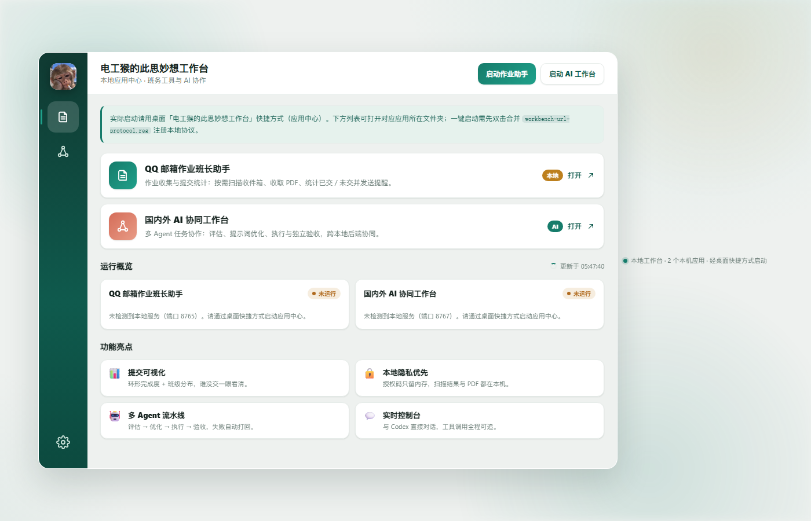
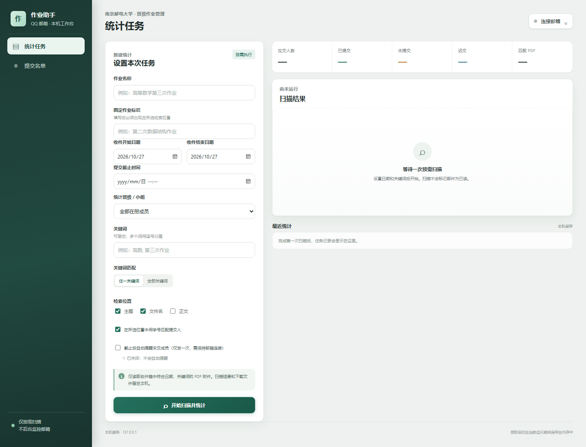

# 电工猴的此思妙想工作台

一个本地「应用中心」：把两个本机应用（国内外 AI 协同工作台、QQ 邮箱作业班长助手）收进一个悬浮窗口 / 门户页，点一下就能启动。

## 界面预览

工作台门户页（含实时「运行概览」）：



QQ 邮箱作业班长助手：



## 组成

| 文件 | 作用 |
|---|---|
| `电工猴的此思妙想工作台.html` | 应用中心门户页（仿微信/QQ 布局，含"运行概览"实时仪表盘） |
| `launcher.ps1` | 桌面快捷方式的入口：拉起本地门户服务，再用 Edge 应用窗口打开门户页 |
| `portal_server.py` | 本地门户服务：托管门户页，并提供「一键启动两个应用」的接口 |
| `launch-handler.ps1` | `workbench://` 本地协议的处理器（备用方案，现默认不需要） |
| `build-icon.ps1` | 由 PNG 生成多尺寸 `.ico` |
| `*.ico` / `*.png` | 图标素材 |
| `workbench-url-protocol.reg.example` | 注册 `workbench://` 协议的示例（需改成你的实际路径） |

## 目录约定

启动器用相对路径查找两个应用，请把它们克隆到 `apps/` 下并保持文件夹名：

```
工作台/
├─ launcher.ps1
├─ 电工猴的此思妙想工作台.html
└─ apps/
   ├─ domestic-global-ai-workbench/
   └─ qq-email-homework-assistant/
```

```bash
git clone https://github.com/hou13851865503-design/domestic-global-ai-workbench.git apps/domestic-global-ai-workbench
git clone https://github.com/hou13851865503-design/qq-email-homework-assistant.git apps/qq-email-homework-assistant
```

## 使用

- **双击桌面快捷方式（或 `launcher.ps1`）**：后台拉起本地门户服务，确认门户页返回 200 后，用浏览器**独立窗口**打开它——界面就是上面这张图，原生 DPI 渲染，清晰锐利；
- 门户里点应用卡片 / 右上角按钮即可启动对应应用（调用本地服务的 `/api/launch`，不依赖注册表协议）；
- 只想看网页版：直接双击 `电工猴的此思妙想工作台.html`（此时「打开」按钮不可用，因为没有本地服务）；
- 「运行概览」实时显示两个应用的运行状态（检测 8765 / 8767 端口）。若应用已经开着但这里显示"未运行"，说明那个进程是旧版本（缺少状态接口），重启该应用即可。

## 两个应用

- **国内外 AI 协同工作台**：多 Agent 协作（评估 → 出题 → 执行 → 验收），支持"多 AI 协作 · 方案博弈"（4 角色论证 → A/B/C 方案 → 红队压测 → 人工叫停/继续/采纳）。启动前需在该仓库构建 `AI多Agent流水线.exe`（见其 `build.ps1`），或直接 `python platform.py`。
- **QQ 邮箱作业班长助手**：本机网页工具，按需扫描 QQ 邮箱收作业 PDF、统计已交/未交、生成提醒，支持截止后自动提醒。用 `pythonw app.pyw` 启动（Python 3.9+）。

## 说明

本仓库只含工作台本体（门户页 + 启动器 + 图标）；两个应用是独立仓库，见 `apps/` 约定。
